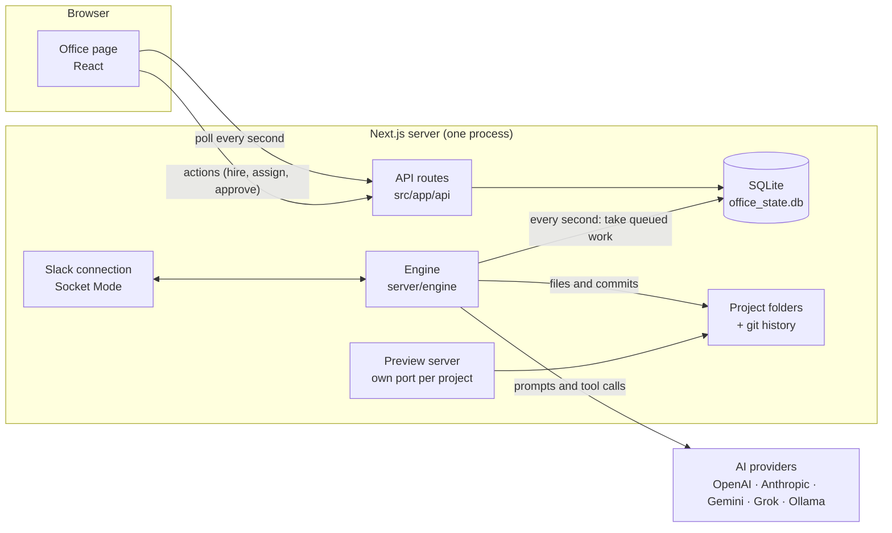

# Architecture

How Deskforce is put together, for anyone changing it. What the office does is described in the [documentation](https://husseinzayat3.github.io/Deskforce/); where each file is, in [CONTRIBUTING.md](CONTRIBUTING.md#where-things-are).

## The big picture

The server owns everything. The browser never calls a model or writes a file: it reads the office's state and asks for changes, and the engine does the work. That is why work carries on with the page closed, and why a restart loses nothing.

## The parts

**The office page** (`src/app/page.tsx`, `src/components/`, `src/lib/SimulationContext.tsx`). One React page. `SimulationContext` polls `GET /api/office` every second, sending the version it already has so an unchanged office costs almost nothing, and holds the state every component reads. The floorplan's walking, coffee breaks and speech bubbles are animation in the browser only; the server knows employees as idle or working.

**The API** (`src/app/api/`). Thin routes: check the request, call `store` or `actions`, answer. Every route first passes the guard in `src/lib/server/guard.ts` (see [Security](#security)).

**The store** (`src/lib/server/store.ts`, `src/lib/db.ts`). Every read and write of the office's state goes through these functions; nothing else touches SQLite. Each change bumps a version number, which is how the browser and the engine notice that something changed. New task columns are added in `db.ts` as migrations, so older databases keep working.

**The engine** (`src/lib/server/engine/`). Started when the server starts (`src/instrumentation.ts`), it ticks every second:

1. `index.ts` — the tick: re-queue work a restart interrupted, respect the pause and the monthly cap, start the oldest pending task of every idle employee, then look for follow-ups and wrap-ups. A tick that finds nothing changed returns at once.
2. `runTask.ts` — one task: build the prompt (`src/lib/agentPrompt.ts`), let the model work, save the result. Models that call tools run in a loop (`src/lib/server/agent.ts`): each tool call is carried out and its result sent back, until the model replies with a summary. Models that cannot call tools write everything in one answer marked up with tags (`src/lib/fileBlocks.ts`). Delegations are checked against the rules (rank, depth, number, duplicates, budget) before they are queued.
3. `meeting.ts` — two employees given the same files agree on a split first.
4. `wrapUp.ts` — once a team's work is in: the manager's follow-up round, the final review, the optional checks, and the report.
5. `schedules.ts` — scheduled templates and the monthly cap.
6. `state.ts` — what lives in memory: the tasks in flight and how to stop them.

Only one process runs the engine for a database: it writes a heartbeat to the store, and another process takes over only when the heartbeat goes stale.

**The providers** (`src/lib/server/llm.ts`). One adapter per provider turns the office's conversation format (`Turn`) into the provider's request and its streamed answer back into text, tool calls and token counts. Costs are estimated from `MODEL_PRICING` in `src/lib/officeConfig.ts`. A provider without a key answers with mock text, which is how the interface and the end-to-end test run for free.

**The workspace** (`src/lib/server/workspace.ts`, `git.ts`). Each request gets a folder under `projects/`. Paths from a model are resolved inside that folder and nothing outside it can be written. Every task that changed files becomes one commit in the employee's name (`isomorphic-git`, so no `git` program is needed), which is what the history and undo in the app show.

**Around it**: `slack.ts` keeps an outgoing Socket Mode connection, so Slack needs no public address; `chat.ts` answers a conversation through the senior employee and the same actions as the buttons; `checks.ts` runs syntax checks and tests, sandboxed on macOS; `preview.ts` serves each previewed project from its own port.

## The desktop app

`electron/main.js` starts the same Next.js server (built as a standalone bundle) in a background process on a free local port, with `OFFICE_DATA_DIR` pointing at the app's data folder, and shows the page in a window. Notifications and "open folder" go through `electron/preload.js`. The build is in `scripts/build-desktop.sh` and `electron/after-pack.js`.

## Security

The office has no login, so its defences are about where requests come from and where agents can reach. The layers, and their tests:

| Layer | Where | Tested in |
| --- | --- | --- |
| Only answer on this computer (host name check, stops DNS rebinding) | `server/guard.ts` | `tests/guard.test.ts` |
| Only accept changes from the office page (origin and JSON checks) | `server/guard.ts` | `tests/guard.test.ts` |
| Model-written paths stay inside the project | `server/workspace.ts` | `tests/workspace.test.ts` |
| Agents only fetch public addresses | `lib/netGuard.ts`, `server/web.ts` | `tests/tools.test.ts` |
| Previews run on another origin | `server/preview.ts` | — |
| Checks run with fixed commands, no office environment, sandboxed on macOS | `server/checks.ts` | — |
| Saved keys never go back to the browser | `server/settings.ts` | — |

What counts as a vulnerability is in [SECURITY.md](SECURITY.md).

## Testing

- `tests/*.test.ts` run with Node's test runner. `tests/helpers/fakeProvider.ts` serves the four providers' streaming formats on this computer, so the real adapters and the engine are tested without keys or network: `tests/llm.test.ts` covers the adapters, `tests/engine.test.ts` whole tasks through the queue.
- `tests/e2e/smoke.e2e.ts` drives the office in a real browser with Playwright, using mock answers.
- `npm run test:coverage` reports how much of `src/lib` the tests reach.

## Decisions worth knowing

- **SQLite and one writer.** The state is small and lives on one computer; a single file needs no setup and is easy to back up or reset.
- **Polling, not push.** One request a second with a version check is simple, survives restarts and sleeping laptops, and costs almost nothing when nothing changed.
- **Tools first, tags as fallback.** Tool calls let a model read before it writes and work in steps; the tag format keeps small local models useful.
- **Git per task.** Every change is attributable and reversible without the office keeping its own history format.
