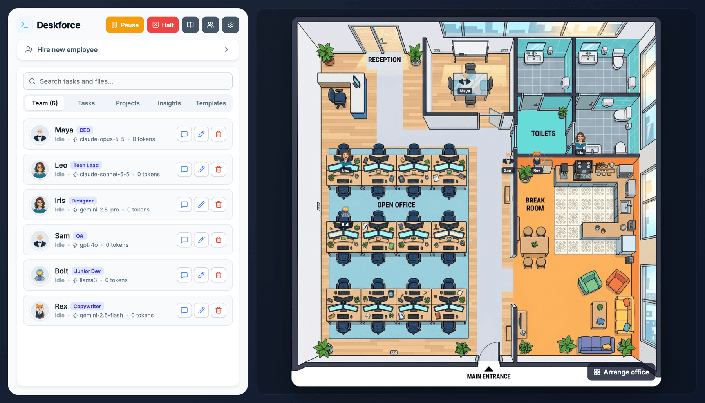

# Deskforce — AI agent office

A virtual office where AI agents work as a team. Hire employees, give the CEO a goal, and watch it get broken down, delegated, and turned into files on your machine — all shown on an animated 2D floorplan.



> **Want a version built for your company or your clients?** I customise it on request: your roles, tools, models, branding and hosting. See [Need it customised? Hire me](#need-it-customised-hire-me) or write to [husseinzayat10@hotmail.com](mailto:husseinzayat10@hotmail.com?subject=Custom%20office).

## Features

- **Your own office** — upload a floorplan and avatars, and drag the desks and rooms to where they are on it. Each desk can belong to a role.
- **Talk to it from Slack** — message the office and your most senior employee answers: it starts tasks, reports how things stand, and tells you when a plan, a question or a report is waiting.
- **Projects and search** — a page per project with its files, cost and requests, and a search across every task and every project file.
- **Visual office map** — each agent is a clickable avatar on the floorplan (click to open its tasks). The speech bubble shows what the model is writing as it writes it, and agents walk to the meeting room, the coffee machine and the break room.
- **Runs on the server** — tasks are executed by the server, not the browser tab. Close the page and the work carries on; after a restart, interrupted tasks go back in the queue.
- **Roles you define** — an office starts with eight roles (CEO, Tech Lead, Designer, QA, DevOps and more). Edit their instructions and seniority or add your own; an agent can only delegate to more junior roles.
- **A model per employee** — OpenAI, Anthropic (Claude), Google Gemini, Grok (xAI) or a local model through Ollama, and the exact model for each hire: a strong one for managers and reviewers, a cheap one for juniors.
- **Shared context** — every agent sees the original request, its manager's plan, what colleagues already finished and the current project files, so work is built on rather than overwritten.
- **Plan first** — a task can start with the employee proposing a plan and a rough cost estimate. Nothing is built until you approve it, edit it, or ask for another.
- **Follow-up rounds** — when delegated work comes back, the manager reads the results, fixes gaps, and may delegate once more before the final review.
- **Questions up the chain** — an employee who is unsure asks the manager who assigned the task and gets the answer straight away; only what the manager cannot decide reaches you.
- **Company knowledge** — a handbook you write (conventions, tone, preferred tools) that every employee is given, plus notes employees save for future projects.
- **Message a running task** — say something to an employee mid-task without halting it.
- **Meetings** — when two agents are asked to change the same file, they meet first, agree who does what, and then work one after the other.
- **Questions** — an agent that cannot do a task without information only you have asks, and carries on when you answer.
- **Final review and report** — when all delegated work is done, the task owner checks the whole project and fixes gaps. Each task you assign then gets a report.
- **Files, history and undo** — browse a project's files in the app. Every task is a git commit in the agent's name: see exactly what it changed and undo it with one click.
- **Preview** — projects with a web page (`index.html`) open in a preview, served from their own local address.
- **Task board** — a nested view of each task and its sub-tasks, with progress, tokens, estimated cost, live output, and buttons to retry, request changes or continue the project.
- **Costs** — spending per day, per employee and per model, a budget per task, and a monthly cap that stops new work when it is reached. Repeated context is cached at the provider, so each further step of a task costs a fraction.
- **Performance** — per employee and per model: success rate, how often the work had to be fixed afterwards, average cost and time.
- **Model comparison** — run the same request on two or three models, each alone in its own project, and compare result, time and cost side by side before deciding who to "hire".
- **Templates and schedules** — save a task to run again with a click, or every day or week at a set time.
- **Real tools, real output** — agents read, write and edit the project's files through tool calls, into a per-task folder under `workspace/projects/`. Models that cannot call tools fall back to a tagged text format.
- **Web access** — agents search the web and read pages for current facts instead of inventing them. They can only reach public websites.
- **Attachments** — give a task files or images to work from, or a whole folder to start the project from.
- **Edit, archive, delete** — change an employee's role or model without losing their history; hide finished tasks or delete them with their files.
- **Checks (opt-in)** — the office can check the syntax of a project's files and run its tests, and have failures fixed. Off by default; on macOS it runs sandboxed.
- **Office files** — export the roles, employees and templates of an office as one file and import it elsewhere.
- **Notifications** — a system notification when a report is ready, an employee has a question, or a task fails.
- **Desktop app** — one command packages the whole thing as a macOS app for Apple Silicon and Intel, with a settings screen for your API keys.

## Download

Installers for the desktop app are on the [Releases page](https://github.com/husseinzayat3/Deskforce/releases/latest). Nothing else needs to be installed; enter your API keys in the app's settings.

| System | File |
| --- | --- |
| macOS, Apple Silicon (M1 and later) | `Deskforce-<version>-arm64.dmg` |
| macOS, Intel | `Deskforce-<version>-x64.dmg` |
| Windows 10 and 11 | `Deskforce-Setup-<version>.exe` |

The apps are not yet signed with a paid certificate, so the system asks before it opens them the first time:

- **macOS:** after trying to open the app, go to **System Settings → Privacy & Security**, scroll down, and choose **Open Anyway**.
- **Windows:** when "Windows protected your PC" appears, choose **More info → Run anyway**.

To run it from the source instead, or with Docker, read on.

## Getting started

### 1. Prerequisites

- Node.js 20.9 or newer (`nvm use` picks it up from `.nvmrc`)
- At least one AI provider:
  - an API key for OpenAI, Anthropic, Google Gemini or xAI (Grok), or
  - [Ollama](https://ollama.com) running locally with the `llama3` model (`ollama pull llama3`) — set `OLLAMA_MODEL` to use a different one

### 2. Install

```bash
git clone https://github.com/husseinzayat3/Deskforce.git
cd Deskforce
npm install
```

### 3. Configure

Copy the example environment file and add the keys for the providers you plan to use:

```bash
cp .env.example .env.local
```

`.env.local` is ignored by git. A provider without a key returns mock responses, so you can explore the interface before adding one.

You can also enter keys, models and the Ollama address in the app itself: the gear button opens the settings. Values saved there are kept in the office database and take precedence over `.env.local`.

> **Keys are stored unencrypted.** API keys and Slack tokens saved in the settings are written as plain text to the office database (`workspace/office_state.db`, or `office_state.db` in the desktop app's data folder), just as they are plain text in `.env.local`. Anyone who can read that file can read the keys, so keep it out of backups and folders you share, and never commit or send it.

### 4. Run

```bash
npm run dev
```

Open `http://localhost:3000`, hire a few employees, and assign a task to the most senior one.

## How it works

The office engine (`src/lib/server/engine.ts`) starts with the server and checks the queue every second. Each task is given to the employee's model together with the client's request, the manager's plan, what colleagues finished, and the project's files. The model then works by calling tools until it replies with a summary:

| Tool | Effect |
| --- | --- |
| `name_project` | Names the folder of a new project |
| `list_files`, `read_file` | Look at the project as it is now |
| `write_file`, `edit_file`, `delete_file` | Create, change or remove a file in the project folder |
| `delegate` | Hands a sub-task to a more junior colleague |
| `ask_manager` | Asks the manager who assigned the task; the answer comes back at once |
| `ask_client` | Pauses the task and asks you |
| `save_note` | Writes down a lesson for future projects |
| `web_search`, `fetch_url` | Look something up (Claude uses Anthropic's own web tools instead) |
| `post_to_slack` | Tells you something in Slack, when it is connected |
| `run_checks` | Checks syntax and runs tests, when you turned that on |

Every task that changes files becomes one git commit in the employee's name. A model that cannot call tools (for example `llama3` on Ollama) is given the same abilities as tags in plain text, such as `[FILE: path] … [/FILE]`; it has no web access and cannot run checks.

The guardrail limits, the per-model prices and the discounts for cached input used for cost estimates live in `src/lib/officeConfig.ts`. Costs are estimates from list prices; local Ollama models count as free.

| Part | Technology |
| --- | --- |
| Frontend | Next.js (React), `framer-motion` |
| Backend | Next.js API routes, plus an in-process engine that runs the tasks |
| Database | `better-sqlite3` |
| AI | OpenAI SDK (OpenAI and Grok), Anthropic SDK, Gemini and Ollama HTTP APIs, all streamed, with native tool calling |
| History | `isomorphic-git` (no `git` program needed) |

## Slack

The office can be reached from Slack without exposing your computer to the internet: it opens the connection to Slack itself (Socket Mode).

1. At [api.slack.com/apps](https://api.slack.com/apps) choose **Create New App → From a manifest**, pick your workspace, and paste:

   ```yaml
   display_information:
     name: Deskforce
   features:
     bot_user:
       display_name: Deskforce
       always_online: true
     app_home:
       messages_tab_enabled: true
       messages_tab_read_only_enabled: false
   oauth_config:
     scopes:
       bot:
         - chat:write
         - im:history
         - app_mentions:read
   settings:
     event_subscriptions:
       bot_events:
         - message.im
         - app_mention
     socket_mode_enabled: true
   ```

2. Under **Basic Information → App-Level Tokens**, create a token with the `connections:write` scope. It starts with `xapp-`.
3. Under **Install App**, install it to the workspace and copy the **Bot User OAuth Token**. It starts with `xoxb-`.
4. In the office, open Settings → Slack and paste both tokens. The status line shows "Connected".
5. Send the app a direct message. It answers with your Slack user ID; add that ID to the allowed users in Settings. From then on it takes your instructions.

Only the listed users can give instructions; everyone else is told so and nothing happens. In a channel, mention the app (`@Deskforce status`) after inviting it.

What you can say is free text: "build me a landing page for the bakery", "how are things?", "approve the plan", "tell them to use blue instead", "cancel that". The employee who answers works through the same actions as the buttons in the app, and the office posts to your conversation when a plan or a question is waiting, a report is ready, or a task failed.

The same conversation is available to scripts on this computer:

```bash
curl -X POST http://localhost:3000/api/chat -H 'Content-Type: application/json' -d '{"text":"how are things?"}'
```

Chatting uses the answering employee's model and counts towards the monthly spending.

## Checks

In Settings, "Run checks and tests on this computer" lets the office verify a project: JSON, Python, JavaScript and Dart files are checked for syntax, and Python (`unittest`) and JavaScript (`node --test`) tests are run. When a task tree finishes with failing checks, its owner gets one round to fix them and the checks run again; the result is in the report. Agents can also call the checks themselves while working.

Tests are code that a model wrote. The commands are fixed (never chosen by a model), run without the office's environment, and on macOS inside a sandbox with no network, no writing outside the project, and no reading of your documents, keys or the office's own data. On other systems there is no sandbox, so leave it off unless the office already runs in a container. Nothing is installed: tests can only use what is already on the computer.

## Tests

```bash
npm test            # unit tests: response parser, pricing, schedules, and what the office refuses (hosts, origins, paths, addresses)
npm run lint
npm run typecheck
```

All three run on every pull request. To contribute, see [CONTRIBUTING.md](CONTRIBUTING.md); to report a security problem, see [SECURITY.md](SECURITY.md).

## Desktop app

The app is built on the system it is for:

```bash
npm run dist:mac                  # on a Mac, for its processor
MAC_ARCH=both npm run dist:mac    # one app for Apple Silicon, one for Intel
npm run dist:win                  # on Windows, from Git Bash
```

This builds `dist-desktop/Deskforce-<version>-<arch>.dmg` on macOS and `dist-desktop/Deskforce-Setup-<version>.exe` on Windows. Add `-- --dir` to build only the app without an installer, which is quicker when you just want to try it.

The app contains the server and the engine, and listens on this computer only. Its data (the database, a `projects` folder, and `server.log`) lives in `~/Library/Application Support/Deskforce/` on macOS and `%APPDATA%\Deskforce\` on Windows; "Open folder" on a task shows the project there. There is no `.env.local` in the app: enter your API keys in its settings, and the app notifies you when something needs you.

On macOS, closing the window keeps the agents working; quit the app to stop them. On Windows, closing the window quits the app, and unfinished tasks go back in the queue for the next start.

**Signing.** Without an Apple Developer ID the app is ad-hoc signed: it runs on the Mac that built it, and on another Mac it has to be allowed the first time under System Settings → Privacy & Security → Open Anyway. To distribute it properly, set these before building (see the top of `scripts/build-desktop.sh`):

```bash
export CSC_NAME="Developer ID Application: Your Name (TEAMID)"   # the certificate in your keychain
export APPLE_ID=you@example.com APPLE_APP_SPECIFIC_PASSWORD=xxxx-xxxx-xxxx-xxxx APPLE_TEAM_ID=TEAMID   # notarisation
```

On Windows, set `CSC_LINK` to a code-signing certificate (`.pfx`) and `CSC_KEY_PASSWORD` to its password; without them the installer works but SmartScreen warns the first time.

**Updates.** An installed app can update itself: on Windows always, on macOS only when it is signed. Tell the build where new versions will be, then upload the installers and the `latest*.yml` files of each release there (on macOS also the `.zip`):

```bash
export DESKFORCE_UPDATE_REPO=owner/repo        # a public GitHub repository's releases, or
export DESKFORCE_UPDATE_URL=https://example.com/downloads
```

The app then checks at start and every few hours, downloads a newer version in the background, and installs it when it is next quit.

**Releasing.** Set the new `version` in `electron/package.json`, commit, and push a tag with the same number:

```bash
git tag v0.2.0 && git push origin v0.2.0
```

`.github/workflows/release.yml` then builds the macOS and Windows installers and attaches them to a draft release. Read the draft on the Releases page and publish it. The workflow signs the apps when the certificates are stored as repository secrets, which are listed at the top of that file.

## Docker

```bash
docker build -t deskforce .
docker run -p 127.0.0.1:3000:3000 -v $(pwd)/workspace:/app/workspace --env-file .env.local deskforce
```

Mount `/app/workspace` as shown to keep the generated files and the database. To use Ollama from the container, point `OLLAMA_URL` at the host, for example `-e OLLAMA_URL=http://host.docker.internal:11434`.

## Security

The office has no login, so it is built to be used from the computer it runs on:

- `npm run dev` and `npm start` listen on `127.0.0.1` only, and the API refuses requests addressed to any other host name. To reach it under another name (for example behind your own reverse proxy with authentication), list the names in `OFFICE_ALLOWED_HOSTS`.
- Requests that change anything are accepted only from the office page itself, so another website open in your browser cannot assign tasks or change settings.
- The browser cannot call a model or write a file directly; it can only queue tasks. Files are written by the engine, and only inside the task's project folder.
- A project preview is served from a separate local address: the page a model wrote cannot reach the office.
- Agents with web access can fetch public pages only. Addresses on this computer or a private network are refused, so an agent cannot be talked into reading the office's own API or a device on your network.
- Running checks is off by default; see [Checks](#checks) for what it does and how it is contained.
- API keys and Slack tokens saved in the settings are stored unencrypted in the office database on this computer. The settings screen never sends a saved key back to the browser, only its last four characters.
- Halting the office, or removing an employee, stops their model calls straight away.

Do not expose it to the internet without adding authentication first.

## Need it customised? Hire me

This project is open source and free to use as it is. If you want it shaped around your company or your clients, I build customised versions on request:

- **Your team and workflow** — your own roles, instructions, approval steps and reporting.
- **Your tools** — integrations with the systems you already use (ticketing, CRM, chat, internal APIs, your git host).
- **Your models** — other AI providers, private or self-hosted models, your own pricing and spending rules.
- **Your brand** — a custom floorplan, avatars, name and look, packaged as your own desktop app.
- **Your infrastructure** — a hosted, multi-user version with logins and permissions, deployed where you need it.

Tell me what you need and I will reply with a proposal:

**Hussein Zayat** — [husseinzayat10@hotmail.com](mailto:husseinzayat10@hotmail.com?subject=Custom%20office)

## License

[MIT](LICENSE) © 2026 Hussein Zayat. You may use, change and redistribute this project, including commercially, as long as the copyright notice is kept.

The default floorplan and avatars in `public/` were generated with Google Gemini and are distributed with the project under the same terms.
