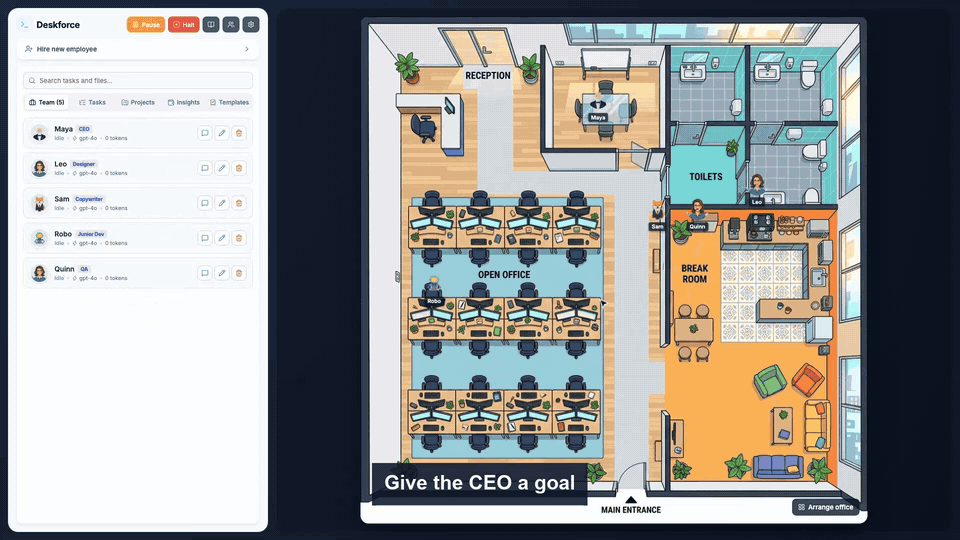
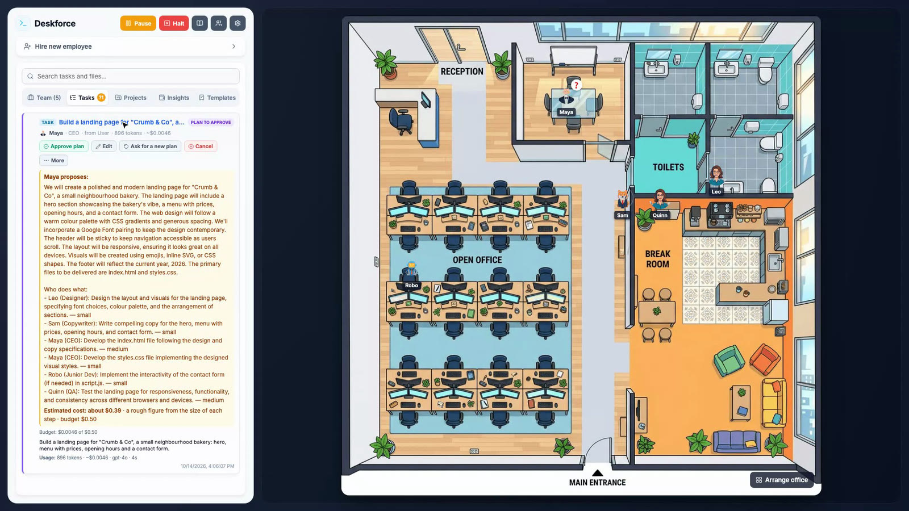
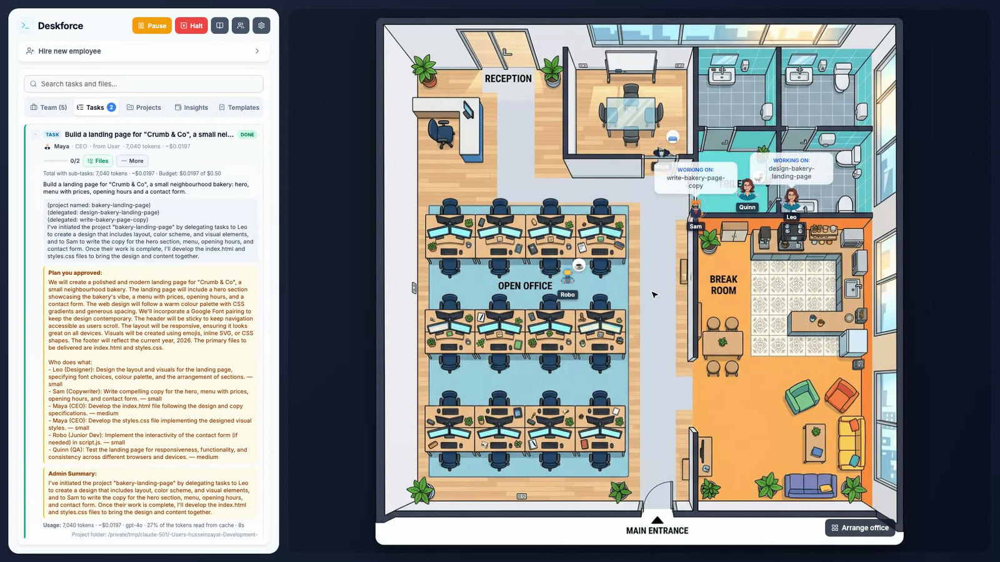
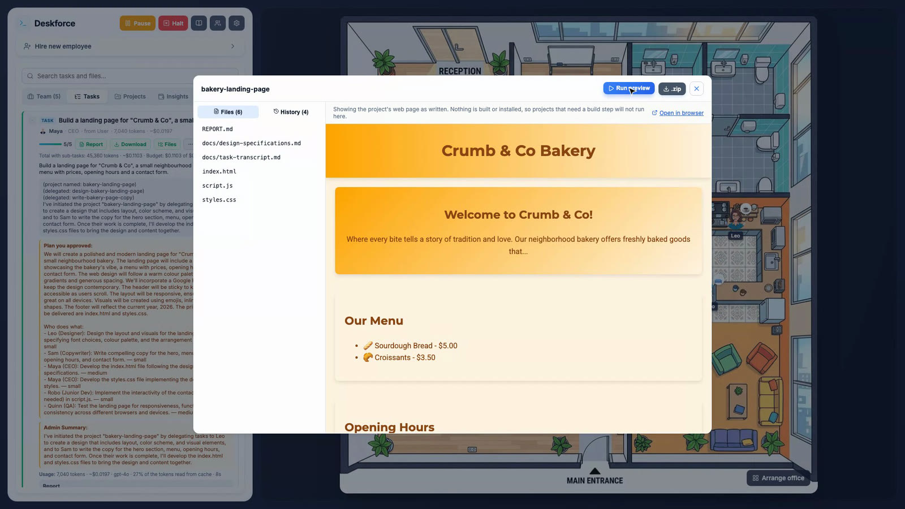
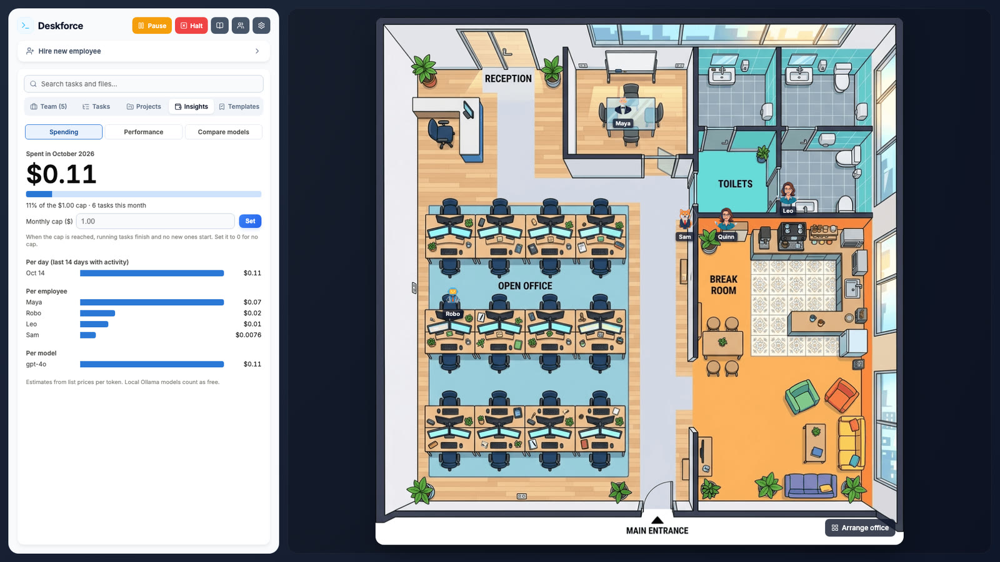
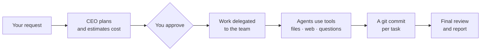

<div align="center">


# Deskforce

**A virtual office of AI agents.** Hire a team, give the CEO a goal, and watch it get planned, delegated and built — with OpenAI, Claude, Gemini, Grok or a local model.

[](https://github.com/husseinzayat3/Deskforce/actions/workflows/ci.yml)
[](https://github.com/husseinzayat3/Deskforce/releases/latest)
[](https://github.com/husseinzayat3/Deskforce/releases)
[](LICENSE)
[](https://github.com/husseinzayat3/Deskforce/stargazers)



<sub>A real run: four employees on gpt-4o built this bakery landing page in about a minute, for $0.11.</sub>

</div>

## Get it

[](https://github.com/husseinzayat3/Deskforce/releases/latest)
[](https://github.com/husseinzayat3/Deskforce/releases/latest)
[](docs/docker.md)

macOS (Apple Silicon and Intel) and Windows installers are on the [Releases page](https://github.com/husseinzayat3/Deskforce/releases/latest); add your API keys in the app's settings. The apps are not signed with a paid certificate yet, so [allow them the first time](docs/getting-started.md#desktop-app).

**Docker** (Intel and ARM):

```bash
docker run -p 127.0.0.1:3000:3000 -v $(pwd)/workspace:/app/workspace --env-file .env.local ghcr.io/husseinzayat3/deskforce
```

**From the source** (Node.js 22+):

```bash
git clone https://github.com/husseinzayat3/Deskforce.git && cd Deskforce
npm install && cp .env.example .env.local   # add a key, or use Ollama for free
npm run dev                                  # open http://localhost:3000
```

No key yet? Providers without one answer with mock text, so you can explore the interface first. Full setup: [Getting started](https://husseinzayat3.github.io/Deskforce/getting-started).

## Why Deskforce

- 👀 **Watch your team work** — every employee is an avatar on a floorplan; speech bubbles show what each model is writing as it writes it.
- 🧠 **A model per employee** — a strong model for the CEO and reviewers, a cheap one for juniors, from any provider.
- ✅ **Approve before anything is spent** — the CEO proposes a plan with a cost estimate; nothing is built until you approve it.
- ↩️ **Undo anything** — every task is a git commit in the employee's name: see what it changed and revert it with one click.
- 💰 **Costs under control** — a budget per task, a monthly cap, spending per employee and model, and side-by-side model comparisons.
- 💬 **Works from Slack** — ask for work, check progress and approve plans from a Slack message.
- 🔒 **Runs on your computer** — files stay on your machine, and with Ollama nothing leaves it at all.

[All features →](docs/features.md)

## Screenshots

<table>
  <tr>
    <td><br><sub><b>Plan first</b> — approve, edit or ask for another plan</sub></td>
    <td><br><sub><b>The team at work</b> — live output on the floorplan</sub></td>
  </tr>
  <tr>
    <td><br><sub><b>Files, history and preview</b> — the result, inside the app</sub></td>
    <td><br><sub><b>Costs</b> — per day, employee and model, with a monthly cap</sub></td>
  </tr>
</table>

## How it works

You give a request to your most senior employee. It plans the work, and once you approve, delegates parts to more junior colleagues, who can only hand work further down. Each agent works by calling tools — reading and writing project files, searching the web, asking its manager or you — and every finished task is committed to the project's git history. When all the work is in, the owner reviews the whole project, fixes gaps and writes you a report.



More: [How it works](docs/how-it-works.md) · [Slack](docs/slack.md) · [Checks](docs/checks.md) · [Desktop app](docs/desktop-app.md)

## How it compares

| | Deskforce | Agent frameworks<br/><sub>CrewAI, AutoGen, LangGraph</sub> | AI software-company projects<br/><sub>ChatDev, MetaGPT</sub> |
| --- | --- | --- | --- |
| What it is | An app you install and use | Libraries you build agents with in code | Research projects you run from Python |
| Getting started | Download, add a key | Write and host your own code | Set up a Python environment |
| Seeing the work | Live floorplan, task tree, live output | Logs and tracing tools | Logs, plus replay tools |
| Spending control | Plan approval, task budgets, monthly cap | Yours to build | Not the focus |
| Undo | One click, per task | Yours to build | Not the focus |
| Use from chat | Slack | Yours to build | — |

Frameworks are the right choice when you are building agents into your own product. Deskforce is for getting work done with a team of agents today, and seeing what they do.

## Documentation

- **Docs:** [husseinzayat3.github.io/Deskforce](https://husseinzayat3.github.io/Deskforce/) — getting started, concepts, providers, costs, Slack, FAQ and troubleshooting (also readable in [docs/](docs/README.md))
- **Contributing:** [CONTRIBUTING.md](CONTRIBUTING.md) — setup, tests, and what a pull request needs · [ARCHITECTURE.md](ARCHITECTURE.md) — how it is built
- **Security:** [the security model](docs/security.md) · report a vulnerability via [SECURITY.md](SECURITY.md)
- **License:** [MIT](LICENSE) © 2026 Hussein Zayat — free to use, change and redistribute, including commercially. The default floorplan and avatars in `public/` were generated with Google Gemini and are distributed under the same terms.

## Need a custom version?

Deskforce is free and open source. If you want it shaped around your company or your clients, I build customised versions:

- **Your team and workflow** — your own roles, instructions, approval steps and reporting.
- **Your tools** — integrations with the systems you already use: ticketing, CRM, chat, internal APIs, your git host.
- **Your models** — other AI providers, private or self-hosted models, your own pricing and spending rules.
- **Your brand** — a custom floorplan, avatars, name and look, packaged as your own desktop app.
- **Your infrastructure** — a hosted, multi-user version with logins and permissions, deployed where you need it.

Tell me what you need and I will reply with a proposal: **Hussein Zayat** — [husseinzayat10@hotmail.com](mailto:husseinzayat10@hotmail.com?subject=Custom%20office) · [husseinzayat.it](https://husseinzayat.it)
