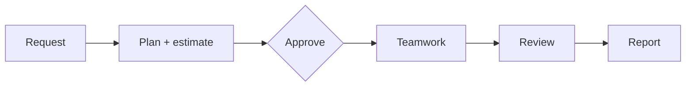

# Concepts

Deskforce works like a small company. You are the client; the employees are AI models, each with a role. This page explains how they are organised and how a request becomes finished work.

## Employees and roles

An **employee** is a name, an avatar, a **role** and a **model** — for example *Maya, CEO, gpt-4o*. You hire as many as you like, and can change an employee's role or model later without losing their history.

A **role** has a name, written **instructions** that every employee in it is given, and a **rank**. A new office starts with eight roles:

| Rank | Roles |
| --- | --- |
| 0 | CEO |
| 1 | Tech Lead |
| 2 | Designer, HR, QA, DevOps |
| 3 | Copywriter, Junior Dev |

Edit them, remove them or add your own under the **Roles** button. Desks on the floorplan can belong to a role, so employees sit with their team.

## Seniority and delegation

Rank 0 is the most senior. **An employee can only delegate to someone with a higher rank number** — the CEO to a Tech Lead or a Designer, a Tech Lead to a Junior Dev — never sideways or upwards. This keeps work flowing down a clear chain instead of bouncing between colleagues.

Delegation has limits that keep a task from growing without end:

- **Three levels at most.** The task you assign and two levels of hand-offs below it; employees at the third level do their part themselves.
- **Four sub-tasks per task** at most.
- **No duplicates.** An assignment that repeats work already in the project is held back.

When a hand-off breaks a rule, it is not dropped: it waits on the task board with the reason, and you decide whether it runs (**Approve**) or not.

## Plans

With **plan first** on (the default, also a checkbox per task), the employee you assign the request to first proposes a plan: what will be built, who does what, how big each step is, and an estimated cost. Nothing is written and nothing else is spent until you:

- **Approve** it as it is,
- **Edit** it yourself and approve your version, or
- **Ask for another** plan, saying what should change.

The approved plan is passed down, so everyone on the team works from the same picture.

## Shared context

Every employee is given the original request, their manager's plan, a short summary of what colleagues have already finished, and the project's current files. Work is built on what is there, rather than started again from scratch.

## Questions

- **To the manager:** an employee who is unsure asks the colleague who assigned the task, and gets an answer straight away (up to three questions per task).
- **To you:** when only you can answer — a preference, a missing detail — the task pauses with a question on the board (and in Slack, if connected). It carries on when you reply.
- **From you:** you can message a running task at any time to steer it, without stopping it.

## Meetings

When two employees are handed work that names the same file, they would overwrite each other. So before either starts, they **meet**: the first proposes who changes what, the others answer, and the last writes down the agreed split. Then they work **one after the other** on those files. You can watch the meeting happen in the meeting room on the floorplan.

## Follow-up rounds

When the work a manager delegated comes back, the manager gets a **follow-up round**: they read what the team delivered, fix gaps themselves, and may delegate once more. There is one follow-up round per task, and none once the task's budget is used up.

## Final review and report

When every task in the tree is finished and more than one person worked on the project, the employee who owns the request does a **final review** of the whole project. They list everything the request and the plan asked for, check each item against the files, check that the files work together, and fix what they find. Their summary marks each item ✓ or ✗. Then the office writes a **report** for you: what was asked, who did what, the files delivered, tokens and cost.

**An automatic check helps the review.** Before the manager's follow-up round and before the final review, the office reads the files and looks for places where they do not fit together: a page that links a file that is not there, pages that ignore the project's stylesheet or that no page links to, imports of missing files or functions, a Python script whose entry point comes before the functions it calls. Whatever it finds is given to the reviewer to fix, and anything still there at the end is listed in the report. When an employee replaces a whole file and functions it had disappear, they are told which ones.

If [checks](checks.md) are turned on, the project's syntax and tests are checked before the report, and failures get one round of fixing. Work you send back with **Request changes** gets a round of its own.

## Projects and history

Each request you assign gets its own **project folder**, named by the employee who starts it. Every task that changes files becomes a **git commit** in that employee's name, so you can see exactly what each one changed and **undo** it. **Continue project** sends a new request to the same folder, and the team is told what was asked before.

## Company knowledge

- **The handbook** is text you write once — conventions, tone, preferred tools — and every employee is given it with every task. It is the simplest way to raise the quality of everything the office produces.
- **Notes** are lessons employees save for future projects (a couple per task at most). You can read and delete them under the **Knowledge** button.

## Templates and schedules

Save a request as a **template** to run again with a click, or on a **schedule**: every day, or every week on a set day, at a set time.

## Next

- [Providers & models](providers-and-models.md) — which model to give each employee
- [Costs & budgets](costs-and-budgets.md) — what a task costs and how to limit it
