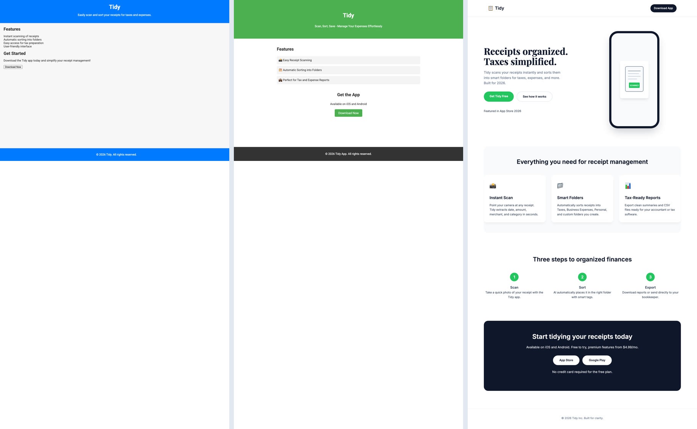

# Examples

Real runs of the office, kept as they came out: the request, the files, the office's report and the transcript of the work, with what it cost and how long it took.

| Example | What it shows | Cost |
| --- | --- | --- |
| [Same request, three models](model-comparison/) | **Compare models** on one landing page: `gpt-4o-mini`, `gpt-4o` and `grok-3` side by side | $0.001 – $0.069 per model |
| [A landing page by a team of four](bakery-landing-page/) | Plan, hand-offs, a follow-up round, the final review and the report | $0.11 |

Costs are the office's estimates from list prices at the time of the run. The same request can come out differently on another run, so treat these as typical rather than guaranteed.
