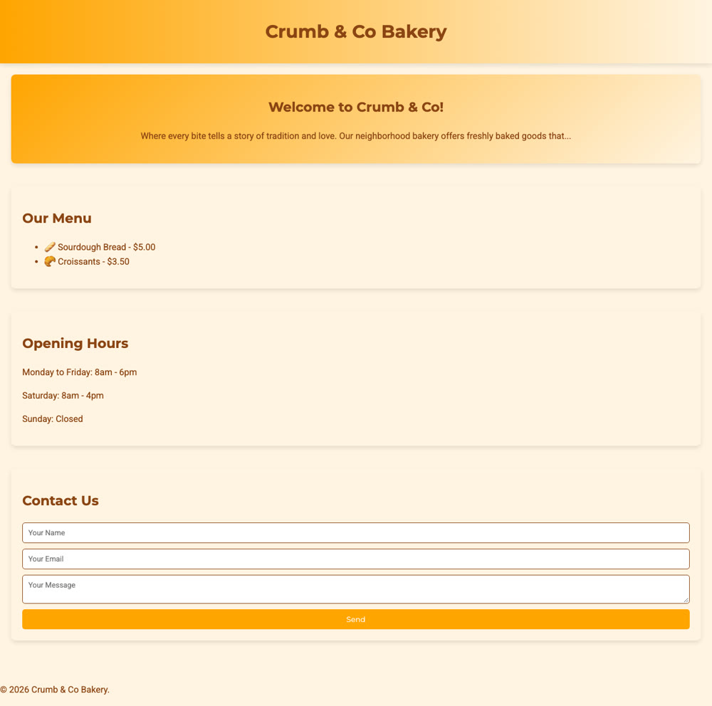

# A landing page by a team of four

The run recorded for the [demo video](../../docs/demo.gif): the CEO planned the page, a designer and a copywriter worked on it, a junior developer added the form's validation, and the CEO reviewed the whole project.

> Build a landing page for "Crumb & Co", a small neighbourhood bakery: hero, menu with prices, opening hours and a contact form.

| | |
| --- | --- |
| Team | Maya (CEO), Leo (Designer), Sam (Copywriter), Robo (Junior Dev), all on `gpt-4o` |
| Tasks | 6: the request, two hand-offs, a follow-up round with one more hand-off, and the final review |
| Cost | $0.11 (45,360 tokens), against a budget of $0.50 |
| Time | 45 seconds from the request to the report, including the plan |
| Date | 14 October 2026 |

## How the work went

1. **Plan.** Maya proposed a plan with who does what and an estimated cost; it was approved as it was.
2. **Hand-offs.** Leo wrote the design specification (`docs/design-specifications.md`): fonts, a warm palette, gradients, layout. Sam wrote the copy.
3. **Follow-up round.** With their work in, Maya built `index.html` and `styles.css` from it, and handed the form's validation to Robo (`script.js`).
4. **Final review and report.** Maya checked the project against the request; the office wrote [`REPORT.md`](project/REPORT.md).

The whole trail, including what each employee did and every file they wrote, is in [`project/docs/task-transcript.md`](project/docs/task-transcript.md).

## What to check

The page is a good first version, not a finished site. Sam's copy listed five menu items and different opening hours, but the page shows two items and its own hours, and the welcome text ends in "…". This is the kind of thing to send back with **Request changes**, and a reason the office ends every project with a report for you to read.

Open [`project/index.html`](project/index.html) in a browser to see it live.
